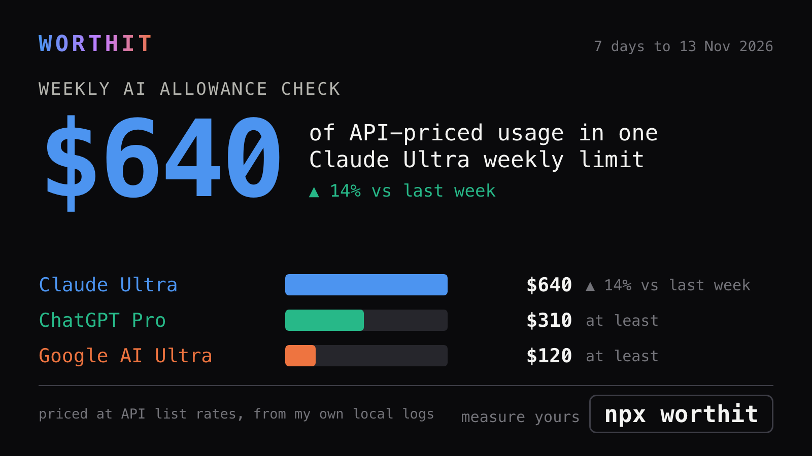

<h1 align="center">Is your AI coding plan worth it?</h1>

<p align="center">
  <b>worthit</b> prices every request in your local Claude Code, Codex and Antigravity logs at API rates,<br>
  and shows what one weekly limit of each plan was really worth. One command. Nothing to sign up for.
</p>

<div align="center">

[**npm**](https://www.npmjs.com/package/worthit) · [**Get more out of your plan**](#get-more-out-of-what-you-pay-for) · [**Share a stat**](#share-a-stat) · [**For agents**](#for-agents)

</div>

**What it answers:** what a weekly limit is worth in dollars · which plan gives more for its price · tokens and cost per model, per tool, per day · cost per merged PR · what a shipped feature costs, week by week · allowance you paid for and did not use · how much of your work runs on open models · whether a provider moved your limit.

## For humans

```sh
npx worthit@latest
```


It reads the logs your AI coding tools already keep, prices every request at API list rates and shows what one full weekly limit of each plan was worth. No account, no upload. The recording is `npx worthit --demo`: the whole run on sample data. Needs Node 22.5+ and Python 3.

## Get more out of what you pay for

The numbers are only useful if they change what you do next week. Each part of the screen answers one question:

| You see | What it tells you | What to do |
|---|---|---|
| **Unused allowance** with dollars still open | You paid for capacity that resets soon | Spend it before the reset: queue the refactor, the test backfill, the long review |
| **A plan at 100% days before its reset** | You are rationing your best model | Move bulk work (search, summaries, boilerplate) to a cheaper or open model and keep the limit for the hard parts |
| **Model mix** with dollars per million tokens | Which models do your volume and what each costs | If an expensive model writes most of your tokens, try the cheap one on the easy half and compare next week |
| **Cost per feature** going up while features stay flat | More usage is not turning into more delivery | Check the Delivery block: which kind of PR grew (fixes, tests, docs) and on which day the cost jumped |
| **Cost per merged PR** going up | You are spending more for each change that ships | Look at the day it jumped: a stuck agent, a retry loop, or one very large PR |
| **The hour grid** | When your agents work and when they sit idle | Idle nights are free capacity: start long jobs before you leave |
| **Plan ranking** | What each plan gives back for its price | Keep the one that pays, question the one that does not |
| **Weekly history** | Whether a limit moved, and when | Tell a provider change from your own busy week before you blame either |

You do not have to read tables. Type a question in the bar at the bottom ("which day cost the most?", "what should I move to an open model?") and it answers with a chart. It remembers the conversation while the screen is open.

A plan marked **measured** was read from its own meter with every machine accounted for. A plan marked **at least** is a value floor: use may be missing from an unread or left-out machine, or logs may have lost hours or days preserved in a saved scan even though the machine answered. Look for the named machine note, such as **kept N older days**; a floor is not compared week to week.

PR, feature and commit counts marked **at least** have incomplete Git source coverage for that count, separately from plan measurement. Sources include logged-in code-host accounts, the local usagemeter store and local `git log`; a failed source or a missing recent checkout can leave a count incomplete. Costs labelled **partial PR count** or **partial feature count** use that partial denominator and drop the comparison; the costs themselves are not lower bounds.

## Share a stat

```sh
npx worthit share
```



It draws a card like this from your last run, writes the post, copies the image and opens X with the text filled in. You paste the image and press Post; worthit never posts for you. You can also just type "share my open model stats" in the question bar.

Topics: `allowance` (did your weekly limits move), `delivery` (what a shipped feature costs, week by week), `open` (open vs closed models), `models`, `value`, `ranking`, `waste`, or anything in quotes: `npx worthit share "what each merged PR cost me"`.

## For agents

Install the skill (the full guide) into whatever agent you use. `npx worthit` also asks "Install the worthit skill?" on its first run and does this for you:

```sh
npx skills add namastex888/worthit
```

`get`, `days` and `sql` query the local store and print JSON; `schema` prints static metadata as JSON.
These commands do not scan or use the network. `--json` and `weekly` scan fresh and print JSON.
Plain runs and `--json` can read remembered selected SSH machines by default. `--json` enables git
data by default and may contact code hosts or download the meter if missing. `weekly` defaults to
every eligible SSH alias in `~/.ssh/config`, excluding code hosts and retired machines, with git
and AI off. `--hosts none` stops SSH for ordinary and weekly scans. `--git no --ai no` disables
ordinary git/code-host/meter collection and agent use.
`share` and `hosts` print JSON when piped; `share` may render a card or use AI for custom topics
(`share --ai no` disables that AI), while `hosts` manages saved machine state. `--no-files` skips
presentation artifacts for plain runs, `weekly` and `share`; network requests and store writes
can still occur. A bare `worthit` or `worthit --demo` draws a dashboard even when piped;
`--demo --json` and `weekly --demo` print sample JSON. `--skill` prints Markdown; `install-skill`
runs `npx skills add` to download the skill (npx may also fetch the installer) and inherits its
output. See the scan flags and “What leaves your machine” below.

```sh
worthit --json                   # scan now, print the week's data (no UI, no model)
worthit weekly                   # fresh allowance checkpoint for a scheduler: JSON, PNG and safety exit code
worthit hosts                    # selected, not selected and retired SSH machines
worthit hosts retire build-box [--since 2026-11-07] # keep saved days, stop asking it
worthit hosts unretire build-box  # restore its saved scan and selection
worthit get                      # sections of the last run, no scan
worthit get plans                # one section; dots walk in: plans.0.usd_per_full_week
worthit days --group month --by tool             # daily history, grouped: day|week|month by total|tool|model
worthit days --since 2026-11-01 --by model
worthit sql "SELECT day, SUM(api_usd) FROM day_provider GROUP BY day"   # one read-only SELECT on the local store
worthit projects                 # saved per-project/model usage and project PR costs, no scan
worthit schema                   # tables and columns, with meanings
worthit share open               # post text, card image and X link from the last run: {topic, text, image, url, warnings}
worthit --skill                  # print the full guide
worthit install-skill            # install the skill into your coding agents
worthit --demo                   # the whole run on sample data
```

`worthit get <section> --demo` reads the same bundled sample as `worthit --json --demo`,
including dotted fields; `worthit get --demo` lists its sections. The standalone
`--demo` flag may also precede the lookup command. `days --demo` and `sql ... --demo`
exit 2 with a one-line error: the sample has no historical query tables. These demo
lookups never read or write your store, even when it is missing or unreadable.

Stored usage never decreases on rescan because tools prune their logs. Each usage
field in `day_provider`, `day_model` and `history.json` keeps its maximum on every
day. Later price cuts or dedupe fixes cannot lower days already stored; higher
values still increase them. Git PR and commit counts keep their independent
14-day, per-metric coverage rules. Saved machines with usage or unreadable saved scans
stay left out after their SSH alias is removed, until retired or covered by a fresh
answer from the same machine.

`worthit days` keeps its bare JSON row array on stdout and prints the day basis
on stderr, in terminals and pipes. Total/tool views use **local days** from
`day_provider`, except that **any `--model` filter uses UTC days** from `day_model`,
even with `--by total` or `--by tool`. `--by model` always uses UTC days.
Never compare these UTC and local views per day. Date filters and week/month
groups use the selected stored basis too, so their boundaries can differ.
This label does not convert stored dates or values.

`worthit weekly [--hosts all|none|a,b] [--allow-partial] [--no-files]` runs a fresh
headless scan with all SSH hosts by default, git and AI off. It prints the fixed allowance
post and facts as JSON, writes `<date>-worthit-share-allowance.png` (Chrome or Chromium
required) and `<date>-worthit-audit.log` beside it, and saves a checkpoint in SQLite's
`weekly` table. The audit uses the plain scan format, including scan reads, commands,
selected SSH hosts and output writes. JSON names the absolute paths in `image` and
`audit_log`; both are null with `--no-files` or `--demo`. `--no-files` skips output
artifacts; the local store is still updated. It never asks questions,
opens browser UI, touches the clipboard or posts.
`worthit weekly --demo` previews synthetic JSON without reading or writing a store or files.

Exit **0** means safe to post; **3** means the JSON is available but a machine is missing,
left out, or has retained units inside this week. Reasons name each machine, and retained
units name their day and provider. `--allow-partial` changes exit 3 to 0, keeping
`safe_to_post: false`. Exit **1** means no result (scan failure, no allowance data this
week, or PNG/audit/store failure). Floors alone, including pre-retirement weeks, and retained units only in earlier weeks are safe.
An exit-1 run still writes the audit log; it prints no JSON and saves no weekly row.

`compared_with` is the latest earlier checkpoint ending at least six days before this
week's end. Only the same plan measured at both endpoints gets a percentage in `plans`,
`moved`, text or card; it never searches past a floor or uses the meter ledger's comparison.
The first checkpoint has null changes. `moved` includes absolute changes strictly greater
than 5%. `worthit schema` and the agent skill describe the complete JSON and table.

### Projects: the last saved rolling week

`worthit projects` reads `last.json` without scanning or making a network request.
It shows per-project API-list value, output tokens, requests, merged PRs and cost per PR;
inside each project, models show those usage counts and their share of its API value.
A terminal gets a table; piped output is JSON, with the `projects` block plus `week`,
`generated_at`, `machines_missing`, `machines_left_out`, `machines_retained` and
`machines_retired`. `worthit get projects` reads the same saved block. `worthit projects --demo`
uses synthetic `github.com/acme/app-api` and `github.com/acme/web-client` projects without a store.
An older saved run needs `worthit --json` once to fill projects.

The rolling seven days match `totals` and git. Project rows plus `no_repository` reconcile with
usage totals (tokens/requests exactly, dollars within whole-dollar rounding). Model shares use
raw API value, not request counts; shares and attributed percent are null at zero total value.
PRs count by their stored host-qualified key, including projects with no usage. Hostless keys
stay in `prs_without_project.why.no_host_in_key`, never matched by repository name.

`floor` is false only when every active machine answered, none was left out, no retained unit
overlaps the week, the week starts on/after each retirement, and there are **zero unresolved
rows**, even rows worth $0. Otherwise usage values, tokens and requests say “at least”; log
usage is never called measured. `coverage.prs_sources` separately checks git sources;
`coverage.prs_attributed` checks that no PR lacks a project. If either fails, PRs say “at least”
and cost says “partial PR count”, never a lower bound. With full PR proof, a usage-only floor says “at least”; a machine floor withholds the cost as null.
All per-PR costs follow the single [RFC 0004 section 3 rule](docs/rfcs/0004-project-stats.md#3-delivery-2-which-model-delivered): machine floors withhold costs, usage-only floors retain linked leads and numeric lower bounds, and floors are never compared. With git off, all PR counts/costs, PR checks and `prs_without_project`
are null; run `worthit --json` to fill them. There is no project comparison or persistent project history.

RFC 0004 delivery 2 adds `projects.delivery`: model and project/model aggregates, `daily`
project/model rows, canonical `deliveries` with member provenance and detailed `coverage`.
Read UTC completion-day data with `worthit get projects.delivery.daily`; these are saved
rolling-window results, not token-spend days. `days --by project` and project history wait
for delivery 3. Physical `git.merged_prs` and each project’s `merged_prs` remain unchanged.

A delivery’s lead is the unique largest positive implementation API-list value on its
canonical project/head branch, with its own `lead_api_value_usd` and `lead_share_pct`.
This is an observed branch-cost association, not authorship or model quality. Ties and
incomplete evidence have no lead (visible in `model: null` rows). Reused branch names
are ambiguous; missing branches, including omp/dsh-tui and old scan units, stay unlinked.
Review branches `review/pr-41-1234abcd` must match the same repository’s PR/MR commit
history uniquely. Review cost never chooses the lead. `usd_per_pr_led` divides **all**
linked implementation plus review cost by `prs_led`, null at zero. `cost_floor: true`
and `cost_reasons` name partial machine/usage/link/window evidence; this is not exact cost.

`first_pass` is explicitly an **opened date proxy**, never a forge review or SHIP verdict.
It uses opening and committer timestamps, which are not push times. Proven base integrations,
base-only history, complete empty changes and narrow docs/images paths do not count as fixes;
code does, even with a docs subject. Missing/truncated ancestry, timestamps or file inventories
and rewritten/unproven merge history are unknown. Four states remain distinct: `first_try`,
`not_first_try`, `unknown`, `not_measured`. Counts are beside rates: `eligible` excludes
unknown/not-measured; `first_pass_pct` is null below five eligible (`insufficient_sample`).

To opt a repository out locally, add `"projects": {"first_pass_exclude":
["github.com/acme/app-api"]}` to your existing `WORTHIT_HOME/settings.json` (default
`~/.worthit/settings.json`). Keep your actual identifiers only there. Opt-out wins over
all automatic and supersede classifications and displays **not measured**.

An entire `Supersedes #41` title on GitHub, or `Supersedes !41` on GitLab, combines a
same-repository transitive chain into one delivery rooted at the original. Its first
merged member sets the UTC completion day; later merges update signal/cost rather than
adding a delivery. A resolved chain is not-first-try. Cycles, self-links, multiple successors,
unavailable or invalid/cross-repository targets remain unresolved and unknown. Coverage
keeps physical/canonical/linked counts, implementation/review rows/tokens/USD, unlinked
usage by reason, no-lead deliveries and each host’s metadata/commit/parent/diff completeness.
Only observed merged items in the last 14 days and resolved predecessors are available;
no future or unseen superseder is inferred. GitHub and self-managed GitLab are supported;
Gitea stays unknown/unlinked, with host-qualified physical keys. Overlapping legacy hostless
Gitea keys are kept in the store but omitted from the current count, with `gitea legacy identities`
marked incomplete and an ambiguous-legacy audit note; no host is guessed, even with one candidate.
Unmatched hostless history/counts remain intact.

Identity is the lowercase origin `host[:nondefaultport]/path`, without credentials, scheme,
trailing `.git` or slash. Each machine reads `.git` (including gitfiles), `commondir` and the
shared `config` directly: no git process, includes or URL rewrites. HTTP(S), SSH, git URLs and
`user@host:path` work; alias hosts with no dot, local paths, ambiguous origins and unreadable
configs stay unresolved. Default ports disappear; nondefault ports remain distinct from forge
PR keys. Fork usage and upstream PRs remain distinct too.

`no_repository.why_usd` names `outside_a_repository` and `no_origin` (no remotes), plus the
unresolved `origin_not_supported`, `folder_gone`, `no_folder_read` (including Antigravity,
omp, dsh and missing cwd) and `saved_before_projects` (older retained scan buckets).
For a deleted folder, sanitized Codex URL wins, then the machine's versioned remembered map,
else `folder_gone`. Only live resolution updates `folder_project (path TEXT PRIMARY KEY,
project TEXT, resolved_at TEXT, ver INTEGER)` in that machine's `scan-cache.db`; it never
leaves the machine or adds a table to `worthit.db`. `WORTHIT_NO_CACHE` or unwritable cache
disables remembering. A pre-delivery deleted worktree can stay unresolved; scan every machine
daily with `worthit --json --hosts all` to remember current folders.

Repository names appear only in local project/JSON output, saved scans and audit logs. Repository, implementation/review branch, commit and known short PR/MR references (`#N`/`!N`)
are excluded from AI summary prompts, question-bar lookups and custom share topics, and from
the dashboard, Markdown and share cards. `worthit schema` and the bundled agent skill describe
the scan's `project`/`project_why`, core `project_activity`, cache and output fields.

## A machine that will never answer again

Run `worthit hosts` to see each SSH machine's state. `worthit hosts retire build-box`
keeps its saved usage and stops asking it, even with `--hosts all` or an explicit alias.
The picker lists retired machines without offering them. Retirement needs a saved scan;
otherwise leave the machine out of the selection. Nothing is retired automatically.
After 14 days without an answer, machine notes suggest the command.

A week can be measured when every active machine answers, none is left out, no saved
retained unit overlaps the week, and its start is on or after every retirement time.
Ledger weeks carry no machine check: `weeks[].proof` is present on week 0, or
`floor` on a ledger week blocked by retirement or retained data; otherwise it is absent.
A pre-retirement week stays a floor; notes name the machine and the first possible
measured week end. Week-over-week changes require two measured weeks.
`--since YYYY-MM-DD` states nothing ran after that date (UTC midnight). It cannot precede
the saved scan's full timestamp or be in the future. Every measured plan relying on it
says "retired since <date>, as stated by you". Without it, wait seven days from retirement.

`worthit hosts unretire build-box` restores the whole snapshot and adds the machine back
to the saved selection. The next answer merges by whole local day/provider: higher API
USD, then more tokens, fresh wins a tie. The same rule handles a retired host answering
under another alias or locally, without counting it twice. Earlier history and checkpoints
stay saved; short windows keep partial-day usage and outside-window git history.
If the frozen snapshot is missing, restore it or use `hosts unretire` to remove the
retirement record and reselect the machine. A corrupt `hosts.json` or invalid
`retired_at` fails with exit 2 and a one-line instruction to fix or remove the file;
`--demo` continues to ignore the store.

Flags for a scan (`worthit` or `worthit --json`):

| Flag | What it does |
|---|---|
| `--git yes\|no` | count commits and merged PRs (each logged-in `gh` account, Gitea when `tea` is logged in, and every logged-in `glab` host; absent or logged-out CLIs are skipped as a source), and read what each PR was from its title prefix |
| `--ai claude\|codex\|omp\|dsh\|no` | which agent writes the summary; `no` = tables only |
| `--ask "question"` | answer one question about the data, then exit |
| `--hosts all\|none\|a,b` | also read your saved ssh machines, in parallel |
| `--days 21` | how far back to scan |
| `--fresh` | rewrite the summary even if nothing changed |
| `--no-files` | do not write the `.md`, `.png` and audit log |

What leaves your machine:

Delivery 1 project statistics add no network request. Every machine also reads the session folders’ `.git` file, `commondir` and shared `config`; each read appears in the audit log. Remote URL credentials are removed on that machine before caching or returning IDs through the existing SSH scan.

- RFC 0004 delivery 2 adds read-only requests to GitHub via `gh`: pull metadata and paginated
  `/repos/:owner/:repo/pulls/:number/commits`, `/repos/:owner/:repo/commits/:sha` (parents,
  committer time, changed files), and `/repos/:owner/:repo/compare/:sha...:base` (ancestry).
  GitLab including self-managed via `glab`: `/projects/:id/merge_requests/:iid`, `/commits`,
  `/projects/:id/repository/commits/:sha`, `/repository/compare`, and paginated recursive
  `/repository/tree?ref=:sha&recursive=true` parent/commit inventories, including file modes.
  Tree inventories avoid silently capped GitLab commit diffs. Supersede targets and ancestors
  use the same families. Every actual request/page is a per-run audit `net` entry; identical
  immutable requests are reused within the run. Limits are 1200 requests, 30 pages per inventory,
  300 items, 40 predecessor depth and 250 graph nodes. Caps/failures yield named unknowns.
  GitHub commit JSON can return file patch text; worthit ignores it and does not persist it. No separate raw-source, forge review-event or mutation requests are made. `--git no` disables all
  these calls and gives `projects.delivery: null`. See [RFC 0004](docs/rfcs/0004-project-stats.md).

- With git data on (the default for `--json`; `--git no` turns it off), GitHub searches through `gh` (one per week of history, per logged-in account, with pagination and smaller slices for full results), requests to every logged-in GitLab host through `glab`, and Gitea requests through the selected `tea` login. Absent or explicitly logged-out CLIs are skipped as a source. Auth discovery through `gh auth status` and `glab auth status` can itself contact code hosts; `glab` can request `gitlab.com/api/v4/user` even without a token. Token-less hosts are skipped as PR sources. If Automagik's open-source `usagemeter` is missing, worthit downloads its manifest and platform binary from GitHub releases, verifies the binary's SHA256, and saves it in the worthit store. Whether already installed or downloaded, the meter runs locally: `sync --no-publish --budget-secs 20` and `status`. The sync publishes nothing. Local `git log` reads checkouts found in the meter store; it does not fetch them.
- With an AI agent, the prompt and week's numbers go through your own Claude, Codex, omp or dsh login to write the summary. With other machines selected from your saved SSH hosts (or remembered from an earlier run), worthit sends the bundled Python scanner over SSH and reads back usage plus sanitized repository IDs; nothing is installed there, but it keeps a scan cache in `~/.worthit/` there. `--hosts none` disables that SSH scan. `--git no --ai no` disables the forge/meter and AI steps; selected SSH scans still run.
- The bundled Python core scans and prices logs locally. When output files are enabled and Chrome or Chromium is installed, worthit's Node CLI runs it to render a local HTML dashboard to PNG in headless mode. In interactive setup, accepting skill installation runs `npx skills add`, which downloads the skill into your coding agents.

The audit log records session-log reads and cache hits, collector commands, network activity, agent calls, sent data and output writes. It does not list executable lookup (`which`), hardware probes, the `zstd` decompressor used for `.zst` logs, the account ids read from Claude and Codex login files (`.claude.json`, `auth.json`; hashed), the model names read from Gemini/Antigravity settings (`.gemini/antigravity-cli/settings.json`, `.gemini/antigravity/settings.json`, `.gemini/settings.json`), `claude-limits.jsonl` in the meter state directories, `~/.ssh/config`, all reads and writes inside worthit's own store folder (`WORTHIT_HOME`, default `~/.worthit`: its database and its sidecar files, caches, saved scans, settings and temporary files), or temporary files and working directories worthit creates under the system temporary folder, including rendering scratch and AI-agent working directories. Some store writes are listed, not all.

A normal dashboard run writes `./<date>-worthit.md`, `./<date>-worthit.png` and
`./<date>-worthit-audit.log`. An ordinary `worthit --json` scan writes only that
audit log, using the shared scan audit format, and names its absolute path in the
root `audit_log` field. It writes no Markdown or PNG and runs no Chrome.
`audit_log` is null with `--no-files` or `--demo`; `--no-files` still updates the
store, while demo reads and writes no store or output files. On exit 1 after
activity, the JSON scan attempts to retain its audit and names the path on stderr,
without printing success JSON. Query commands (`get`, `days`, `sql`, `schema`)
do not scan or write audit files; saved `last.json` and query output shapes stay
unchanged. The store is `~/.worthit/` (or `WORTHIT_HOME`):

| Path | Kept data |
|---|---|
| `hosts.json` | `selected` aliases and `retired: [{machine, retired_at, last_scan_at, since?}]`; old stores without `retired` work unchanged |
| `settings.json` | Remembered dashboard machine, git and AI choices; skill installation choice/status and time |
| `run-keep/<alias>.json` | Latest active scan, merged with saved whole-day/provider winners |
| `run-keep/retired/<alias>.json` | Frozen snapshot moved at retirement; no run changes it; unretire restores its bytes |
| `history.json`, `worthit.db` | Daily usage and git history; the database also holds plan values and weekly checkpoints |
| `last.json`, `weeks/` | Last run and weekly meter reports/ledger |

Run JSON and weekly JSON include `machines_retired: [{machine, retired_at, last_scan_at,
days_kept}]`. These machines never appear in missing/left-out lists. `days_kept` counts
snapshot days selected inside this run's window. Last-run `retirement_conflicts` names
retired machines answering elsewhere. `worthit schema` documents the complete fields.

MIT. Releases: every merge into `dev` cuts a version; `make publish` puts it on npm.
