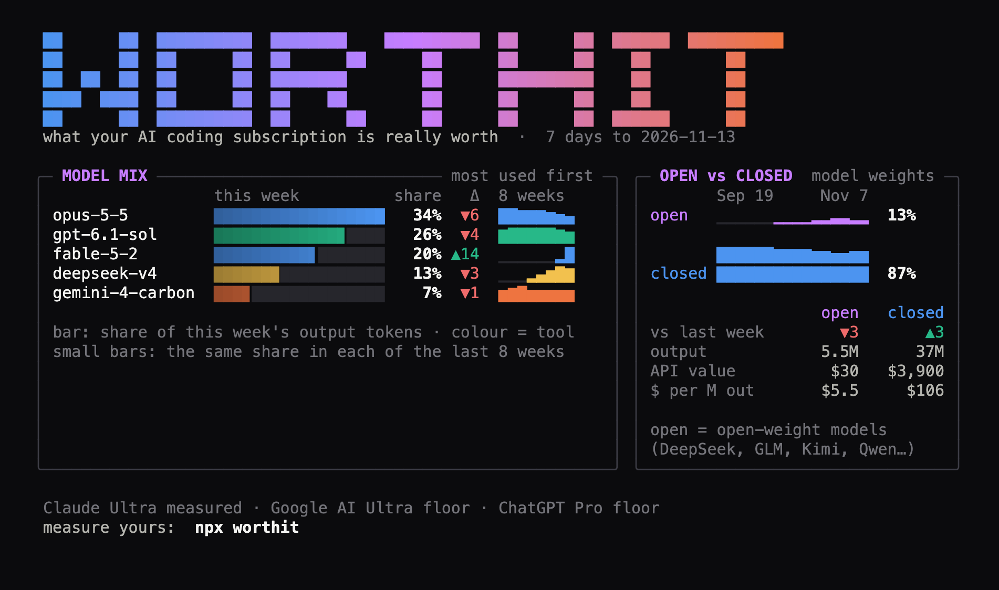

# worthit

What your AI coding subscription is really worth. One command, everything local.

## For humans

```sh
npx worthit@latest
```


It reads the logs your AI coding tools already keep, prices every request at API list rates and shows what one full weekly limit of each plan was worth. No account, no upload. The recording is `npx worthit --demo`: the whole run on sample data. Needs Node 22.5+ and Python 3.

Then share a stat:

```sh
npx worthit share
```



It writes a card like this from your last run, suggests the post, copies the image and offers to open X with the text filled in. You paste the image and press Post; worthit never posts for you. Topics: `allowance` (did your weekly limits move), `open` (open vs closed models), `models`, `value`, `ranking`, `waste`, or anything in quotes: `npx worthit share "what each merged PR cost me"`.

## For agents

Install the skill (the full guide) into whatever agent you use. `npx worthit` also asks "Install the worthit skill?" on its first run and does this for you:

```sh
npx skills add namastex888/worthit
```

Every command prints JSON when piped and reads only local files:

```sh
worthit --json                   # scan now, print the week's data (no UI, no model)
worthit get                      # sections of the last run, no scan
worthit get plans                # one section; dots walk in: plans.0.usd_per_full_week
worthit days --group month --by tool             # daily history, grouped: day|week|month by total|tool|model
worthit days --since 2026-11-01 --by model
worthit sql "SELECT day, SUM(api_usd) FROM day_provider GROUP BY day"   # one read-only SELECT on the local store
worthit schema                   # tables and columns, with meanings
worthit share open               # post text, card image and X link from the last run: {topic, text, image, url, warnings}
worthit --skill                  # print the full guide
worthit install-skill            # install the skill into your coding agents
worthit --demo                   # the whole run on sample data
```

Flags for a scan (`worthit` or `worthit --json`):

| Flag | What it does |
|---|---|
| `--git yes\|no` | count commits and merged PRs (GitHub, plus Gitea and GitLab when `tea` and `glab` are logged in) |
| `--ai claude\|codex\|omp\|dsh\|no` | which agent writes the summary; `no` = tables only |
| `--ask "question"` | answer one question about the data, then exit |
| `--hosts all\|none\|a,b` | also read your saved ssh machines, in parallel |
| `--days 21` | how far back to scan |
| `--fresh` | rewrite the summary even if nothing changed |
| `--no-files` | do not write the `.md`, `.png` and audit log |

What leaves your machine: with `--git yes`, one request to GitHub for your merged pull requests; with an AI agent, the week's numbers go to your own Claude, Codex, omp or dsh login to write the summary. With `--git no --ai no`, nothing does. Every file read and command run is listed in the audit log.

A normal run writes `./<date>-worthit.md`, `./<date>-worthit.png` and `./<date>-worthit-audit.log`. Its store is `~/.worthit/`.

MIT. Releases: every merge into `dev` cuts a version; `make publish` puts it on npm.
