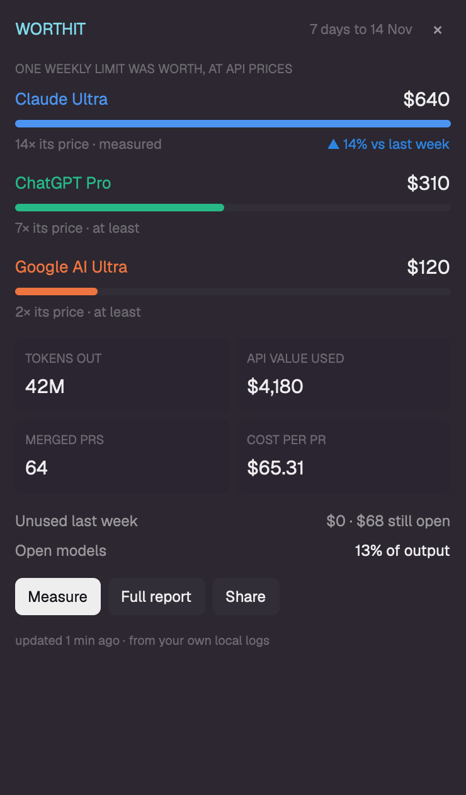

# worthit

A dialog, opened with `ctrl-alt-w`, that shows what your AI coding plans were worth this week: for each plan, the dollars of API-priced usage one full weekly limit gave you, how many times its price that is, and whether the number is measured or a floor. Below that: tokens out, API value used, merged PRs, cost per PR, allowance left unused, and the share of your output that ran on open models. Three buttons run [worthit](https://github.com/namastex888/worthit) itself.

## What you see

A dialog 380px wide and 640px tall, on the theme's `popover` color, 16px padding, 12px between sections. Esc or the × closes it. Top to bottom:

1. **Header row.** `WORTHIT` at 13px semibold in `accent` on the left; `7 days to 13 Nov` at 11px in `dim` on the right (the end of the measured week), then a `×` in `muted` that closes the dialog.
2. **Plans.** A 10px `dim` caption, `ONE WEEKLY LIMIT WAS WORTH, AT API PRICES`. Then one group per plan, highest value first, 10px apart:
   - the plan name at 13px in the plan's own color (it comes with the data: Claude `#4c94f0`, ChatGPT `#27b888`, Google `#ee7440`) and, right-aligned, its value at 15px semibold (`$2,011`);
   - a bar 6px tall with 3px corners: a full-width `raised` track and a fill in the plan's color, as wide as the plan's value relative to the highest plan (never under 2%);
   - an 11px `dim` line: `44× its price · measured` or `14× its price · at least`. For a measured plan with an earlier week, the right side shows `▲ 14% vs last week` in `done` or `▼ 11% vs last week` in `blocked`.
3. **Tiles.** Two rows of two tiles, 6px apart, each on `surface` with 6px corners and 8px padding: a 10px `dim` label over a 15px semibold value. `TOKENS OUT` (`311M`), `API VALUE USED` (`$24,546`), `MERGED PRS` (`437`), `COST PER PR` (`$56.17`). The second row appears only when the data has git numbers.
4. **Two lines** at 12px, label in `muted` on the left, value on the right: `Unused last week` with `$1,049 · $322 still open` (in `blocked` when something went unused; the line is hidden when both are zero) and `Open models` with `28% of output`.
5. **Buttons.** `Measure` (primary: `solid` on `solid_foreground`), `Full report` and `Share` (on `raised`), 12px semibold, 6px corners, wrapping if the column is narrow.
6. **Footer.** 10px `dim`: `updated 12 min ago · from your own local logs`.

With no data yet the dialog shows one paragraph explaining what worthit does and a single `Measure now` button.

## How it behaves

- It does not follow agent status; it shows one file. It reads `~/.worthit/last.json` when it starts and again every 60 seconds, so a run made anywhere (a terminal, another machine's Herdr on the same home) shows up within a minute.
- **Measure** runs `npx -y worthit@latest --json --no-files` in the background, with the 10-minute `exec` limit. While it runs the Measure button is gone and a line under the buttons shows a braille spinner (native `.frames`, 90 ms), `measuring · 2 min 10 s` (updated every 5 seconds) and a note that reading every saved machine can take a few minutes. It ends when `exec` returns or when the file's `generated_at` changes, whichever comes first, so it cannot stay on "measuring" after worthit has finished. A failure shows its last error line in `blocked`.
- **Closing** the dialog does not stop a scan; opening it again shows the new numbers once the file is written.
- **Full report** opens a new tab named `worthit` running `npx -y worthit@latest`: the full terminal dashboard with its question bar.
- **Share** opens a new tab named `worthit share` running `npx -y worthit@latest share`: it asks what to share, draws a card image, writes the post and offers to open X. It never posts by itself.
- Buttons dim to 85% on hover. Nothing else moves. Colors come from `theme()`, so it follows light and dark themes; only the plan colors are fixed.

## Built from

- One mod, `mods/worthit/`: `main.js` and `mod.json` (`{ "place": "none", "title": "worthit", "overlay": { "kind": "dialog", "width": 380, "height": 640 } }`), plus a `keys.json` snippet: `"ctrl-alt-w": "mod.open:worthit"` under `global`. No shared state, no art.
- `herdr` functions: `readTextFile`, `home`, `exec`, `theme`, `run`, `props`, `closeOverlay`. Commands: `tab.new {name, argv}`, and `mod.open {name}` from the key.
- Programs it runs: `npx` (which downloads and runs the `worthit` package from npm, so it reaches the network), only when a button is pressed.
- Files it reads outside its folder: `~/.worthit/last.json`. Fields used: `week.to`, `generated_at`, `plans[]` (`plan`, `color`, `usd_per_full_week`, `times_plan_price`, `proof`, `change_vs_last_week_pct`), `totals.output_tokens`, `totals.api_value_usd`, `git.merged_prs`, `git.usd_per_merged_pr`, `waste[]` (`unused_usd`, `at_risk_usd`), `model_mix.open.share_pct` (last value).
- Elements: `v_flex`/`h_flex` rows, `div` bars with a percent width (`.w("44%")`), `.when(...)` for optional parts, `.frames(...)` for the spinner, `cx.timer.every(60000, ...)` for the reload, `cx.spawn` for file reads and `exec`.

## Watch out

- Do not dock it into the layout (`"place": "right"`): a docked block has no way to be closed by the person. Keep it an overlay.
- A scan gives no progress through `exec`; without the elapsed time and the note it looks stuck for minutes.
- `toLocaleString("en-US")` does not add thousands separators in the mod runtime: format numbers by hand.
- `herdr-app check` renders the empty state only, because the file is read asynchronously. Look at the dialog in the app with real data before calling it done.
- A floor (`proof` other than `measured`) is "at least": never show a week-over-week change for it.
- A first `Measure` on a machine with months of logs can take several minutes; later ones are cached and take seconds. It uses whatever scan settings worthit saved last (other machines, git).
- worthit needs Node 22.5+ and Python 3 on the machine.
- The dialog shows this computer's file only; it does not read a remote space's home.

## Done when

- `herdr-app check mods/worthit` passes.
- With no `~/.worthit/last.json`, the dialog shows the explanation and `Measure now`.
- With a run on disk, each plan shows its name in its color, a value with thousands separators, a bar, and `measured` or `at least`; the highest plan's bar is full width.
- `ctrl-alt-w` opens the dialog; Esc and × close it.
- `Measure` shows the spinner with a growing elapsed time, and the footer reads `updated 1 min ago` after it ends.
- `Full report` and `Share` each open a new tab running worthit.
