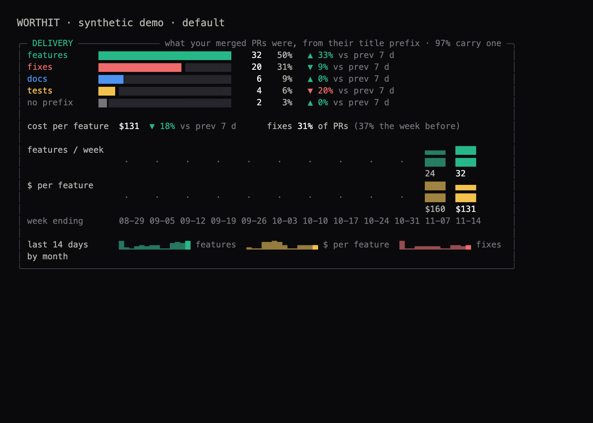
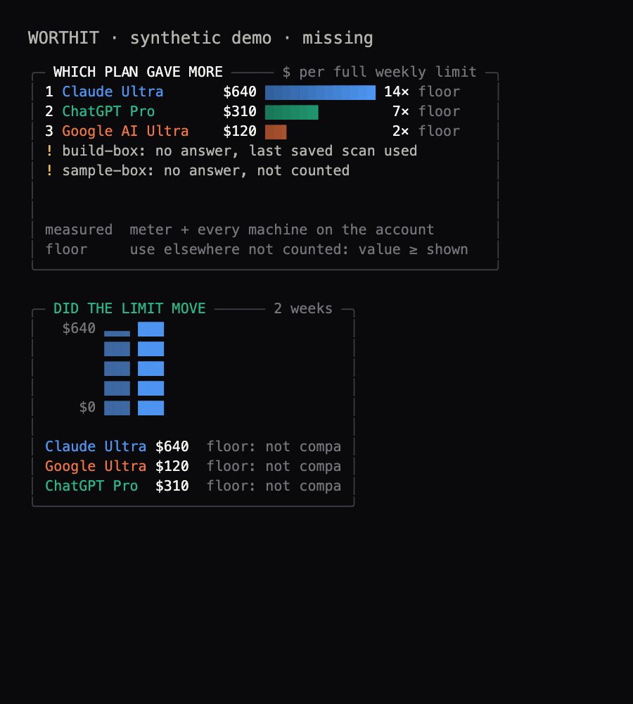
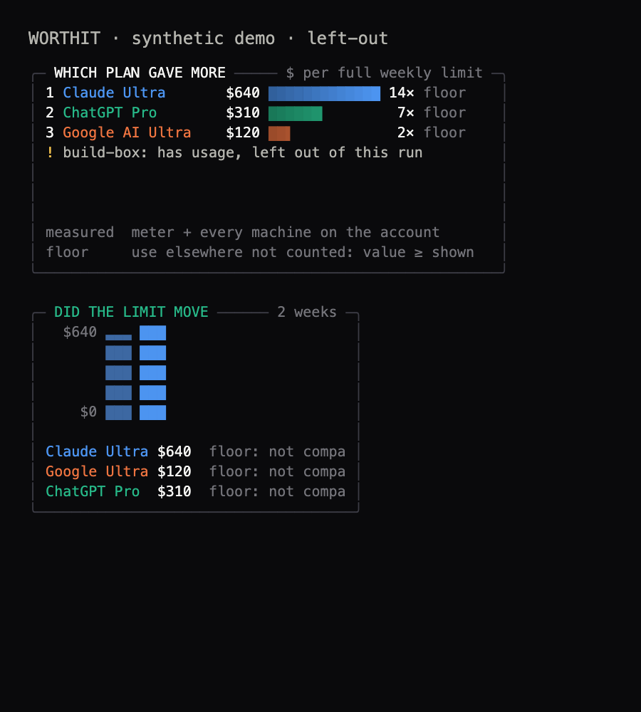
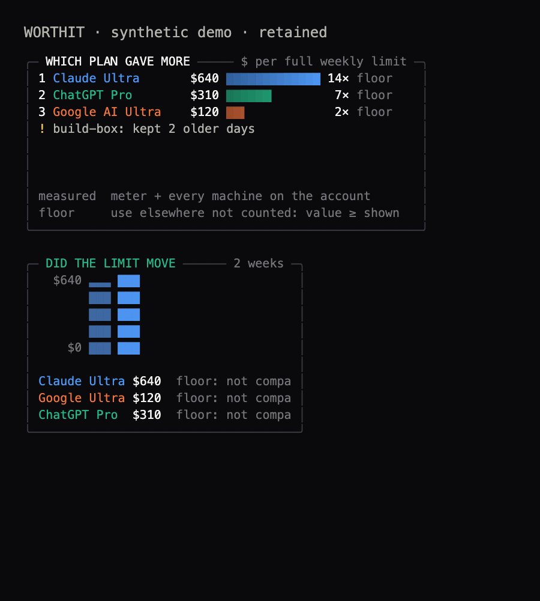

# Demo machine and delivery contract (#29, #36)

The ordinary shipped demo includes empty `machines_missing`, `machines_left_out`,
`machines_retained` and `machines_retired` arrays. Its synthetic 64 merged PRs are
32 features, 20 fixes, 6 docs, 4 tests and 2 without a title prefix. The existing
$4,180 of weekly usage divided by 32 features rounds to $131 per feature.
The earlier week has 59 PRs, 24 features and $3,835 of usage ($160 per feature).
Those totals give the existing +8% PR and +9% usage changes, and an 18% decrease
in rounded cost per feature. Daily rows sum to each week and the current daily
rows match the existing git and usage arrays. Delivery dates move with the demo
week; unrelated sample dates, game and model data are preserved. Only two weeks
of delivery are supplied; older weeks and monthly delivery history are absent.

The fixture executes the actual CLI JSON, default dashboard and supported
`share delivery --demo --no-files --ai no` paths. It checks the actual Delivery
block, card spec, number/date coherence and absence of store creation. Removing
any required machine array or usable delivery fails before the drawing checks.
`test/run-fixtures.mjs` requires this fixture, so `make check` cannot silently
skip it. The original fail-first run on clean `origin/dev`
`eec9fa457e2613105d0f2708eaaf88026af3eef6` exited 1 for all four absent arrays
and unusable delivery, before production demo edits.

The Orchestrator approved fixture-only warning variants without a public flag:

| Variant | Synthetic machine state | Current plan proof |
| --- | --- | --- |
| missing | `build-box` has a saved scan two days before `generated_at`; `sample-box` has no saved scan (`null`) | Every plan is a floor, comparisons null |
| left-out | `build-box` has saved usage omitted from this run (array of aliases) | Every plan is a floor, comparisons null |
| retained | `build-box` keeps two distinct local days, three provider units: Claude and Codex two days ago, Claude three days ago | Every plan is a floor, comparisons null |
| retained-old | One Claude unit twelve days ago, outside this rolling week | Claude remains measured; this week's proof is unchanged |

Proof labels are checked against production `buildData` with a synthetic meter
report in a fresh isolated store per scenario. Real `machineNotes`, PlanRanking,
LimitTrend and allowance card functions are exercised. In incomplete usage
variants, totals are not compared and delivery costs are unavailable (`null`),
while independently complete synthetic PR coverage stays complete. No real store,
scan, usage, SSH connection, model, account or desktop data is used.

## Reproduction and visual evidence

Obtain a fresh Orchestrator identity and explicit shared Mac GO before each run;
run serially through `hc --bg`, wait for its notification and release the slot.

```sh
WORTHIT_FIXTURE_ARTIFACTS=/tmp/worthit-demo-artifacts node test/fixtures/demo-contract/check.mjs
node test/fixtures/demo-contract/render.mjs /tmp/worthit-demo-artifacts default
node test/fixtures/demo-contract/render.mjs /tmp/worthit-demo-artifacts missing
node test/fixtures/demo-contract/render.mjs /tmp/worthit-demo-artifacts left-out
node test/fixtures/demo-contract/render.mjs /tmp/worthit-demo-artifacts retained
```

The fixture constructs its own HOME, command path and cache-disabled store, and
denies Node network calls. The renderer creates a separate synthetic HOME and
Chrome profile, blocks network resolution and renders one image per invocation.
`default.png` extracts the actual CLI's Delivery ANSI output, rather than
reconstructing or stubbing that block. Warning images render the real drawing
functions from saved fixture variants. All four PNGs were opened and inspected:
the default shows the kinds, $131 cost and weekly trend; every warning note is
complete and all affected plan values say floor. The unchanged narrow LimitTrend
box clips the end of its existing `floor: not compared` text; assertions separately
verify no comparison arrows are rendered.

All four render commands exited 0 after validating newly created signed PNGs
with the expected dimensions. Each underlying Chrome process exited 2 with its
known teardown watchdog diagnostic after writing the screenshot (#67/#79).
This fixture records that condition; it does not repair or claim success for the
production share image renderer. The share regression uses `--no-files`, checks
delivery content and explicitly expects no image.





