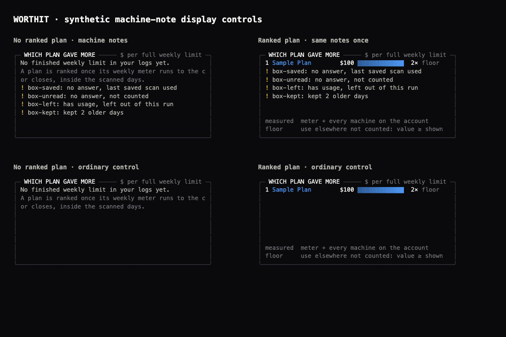

# Machine notes without ranked plans (#41, #42)

`check.mjs` calls the actual `blocks.PlanRanking()` used by the default
dashboard and its plain-line view. Literal synthetic inputs in `data.mjs`
cover retained days, missing machines with and without saved scans, left-out
machines, retirement disclosures/conflicts, the retirement week boundary,
the stale saved-scan prompt and a measured plan's retirement statement.
It checks empty and ranked plans, ordinary controls, note uniqueness, wrapping,
the existing conditional legend and unchanged input data. The fixture is
required by `test/run-fixtures.mjs`, which `make check` runs.

Fail-first on base `eec9fa457e2613105d0f2708eaaf88026af3eef6`:
`node test/fixtures/machine-notes/check.mjs` exited 1: the no-plan block
contained zero occurrences of `box-saved: no answer, last saved scan used`.
After the display fix, the same command exited 0.



`render.mjs` renders those same literal inputs through `blocks.PlanRanking`,
converts the returned ANSI lines to HTML, then screenshots that HTML with real
headless Chrome (1200 × 800). This is the affected drawing block, not a full
interactive TUI capture. No scanner, SSH, AI, personal logs, store or bundled
demo data is used. Both no-plan and ranked notes are visible once; ordinary
controls have no warnings, and only ranked plans have the original legend.
The PNG was opened and visually inspected.

The render command exited 0 with a newly written, signature-validated PNG.
Chrome itself exited 2 **after** writing the screenshot, with
`Teardown watchdog expired` (existing issue #67, tracked by PR #79). This records
screenshot evidence; it does not establish healthy Chrome teardown or repair it.

Reproduce either command with a temporary outer home and store, for example:

```sh
scratch=$(mktemp -d)
mkdir -p "$scratch/home"
HOME="$scratch/home" CFFIXED_USER_HOME="$scratch/home" \
  WORTHIT_HOME="$scratch/store" TMPDIR="$scratch" WORTHIT_NO_CACHE=1 \
  CODEX_HOME="$scratch/home/.codex" CLAUDE_CONFIG_DIR="$scratch/home/.claude" \
  METER_STATE_DIR="$scratch/home/.meter" XDG_CONFIG_HOME="$scratch/home/.config" \
  XDG_STATE_HOME="$scratch/home/.local/state" XDG_DATA_HOME="$scratch/home/.local/share" \
  XDG_CACHE_HOME="$scratch/home/.cache" GH_CONFIG_DIR="$scratch/home/.config/gh" \
  node test/fixtures/machine-notes/render.mjs
```

Use `node test/fixtures/machine-notes/check.mjs` instead for the regression.
The recorded runs additionally used an environment allowlist and canonical
Node/Python paths; config, npm cache and store paths were all synthetic.
